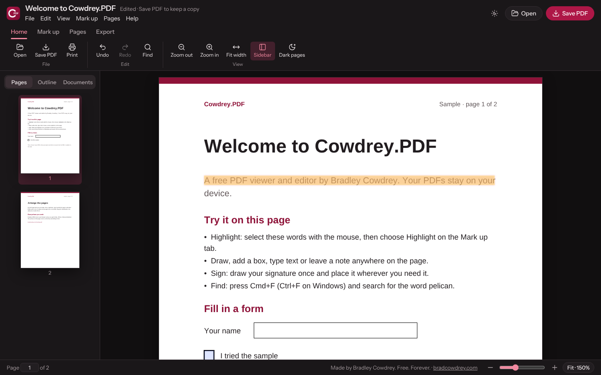

# Cowdrey.PDF

A PDF viewer and editor by **Bradley Cowdrey** · [bradcowdrey.com](https://bradcowdrey.com)

Cowdrey.PDF is Cowdrey.MD's sibling for PDFs: read, mark up, sign, fill forms and rearrange pages, with nothing leaving your device. Like Cowdrey.MD it is one self-contained web page, wrapped as an app for Mac, iPhone, iPad and Android.

**Free. Forever.** Open source under the MIT License.

| | |
|---|---|
| **Use it on the web** | [bradcowdrey.com/cowdrey-pdf/app](https://bradcowdrey.com/cowdrey-pdf/app) |
| **Mac** | [Download Cowdrey.PDF.dmg](https://github.com/bradleycowdrey/cowdrey-pdf/releases/latest/download/Cowdrey.PDF.dmg) · early builds aren't notarized yet: the first time, Control-click the app and choose Open |
| **iPhone, iPad and Android** | Coming soon |
| **Product page** | [bradcowdrey.com/cowdrey-pdf](https://bradcowdrey.com/cowdrey-pdf) |



## What it does

- **Read:** smooth scrolling pages, thumbnails, the PDF's outline, find with every match marked, zoom and fit width, dark mode for the app and an optional dark page.
- **Mark up:** highlight selected text, draw, boxes, text, sticky notes (saved as real PDF comments), signatures (kept on this device for next time) and pictures. Select a mark to move or delete it; undo and redo.
- **Forms:** fill text fields, checkboxes, radio buttons and lists; the values are saved in the PDF.
- **Pages:** rotate one or all, move, duplicate, insert blank, add other PDFs at the end, delete, extract a range as a new PDF; drag thumbnails to reorder.
- **Passwords:** open protected PDFs; when saving, choose whether the copy keeps the password (and its restrictions). Passwords are never stored.
- **Export and share:** a page as an image, all the text, print, or share the PDF.
- **Save:** Save PDF writes your changes into a PDF. With the pages unchanged, the original is kept (bookmarks, forms, links) and the mark-up is added; otherwise a new PDF is assembled.
- **Library:** every PDF you open is kept on this device, with its mark-up, under Documents.

## Apps

The same app runs on the web and, wrapped with Tauri 2, as apps for Mac, iPhone, iPad and Android, built by GitHub Actions (`.github/workflows`). Once the signing secrets are in place, the same workflows produce a notarized Mac DMG with in-place updates, TestFlight builds for iPhone and iPad, and a signed Android APK; until then the Mac DMG is unsigned and the phone apps are compile-checked only. Each platform opens PDFs from its file manager (Finder, Files, Android's Open with). On the Mac, Save writes back to the same file; on iPhone, iPad and Android, Save PDF opens the share sheet (Save to Files, Drive, Mail, AirDrop).

## Built with

pdf.js 6.4.299 (Apache 2.0, its legacy build, so older iPhones and Android web views work too), @cantoo/pdf-lib 2.11.1 (MIT; pdf-lib with password support) and Lucide (ISC).

## Where it lives

- **The web app** is this repo's `index.html`, served by bradcowdrey.com at `/cowdrey-pdf/app`, so every push to `main` is live there within minutes.
- **The product page** is on bradcowdrey.com at `/cowdrey-pdf`.
- **This repo's landing page** (`site/`) is published by GitHub Pages at [bradleycowdrey.github.io/cowdrey-pdf](https://bradleycowdrey.github.io/cowdrey-pdf/).
- **App downloads** are on [Releases](https://github.com/bradleycowdrey/cowdrey-pdf/releases/latest).

## Develop

```
(cd desktop && npm ci)
python3 build.py          # src/ -> index.html
node tests/sample.mjs     # makes the test PDFs in tests/fixtures
node tests/e2e.mjs        # 23 end-to-end tests in Chromium, including the Mac and phone app paths
(cd desktop && node build.mjs) && node tests/bundle.mjs   # the copy the apps ship, offline
```
