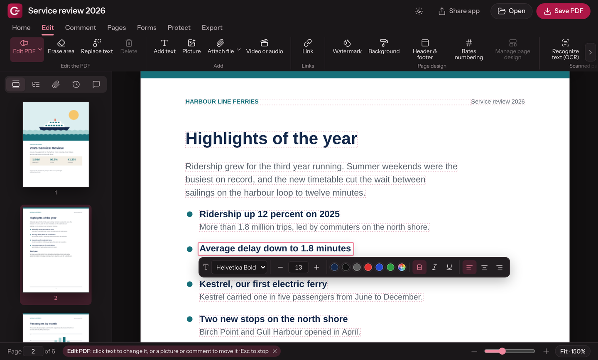

# Cowdrey.PDF

A PDF viewer and editor by **Bradley Cowdrey** · [bradcowdrey.com](https://bradcowdrey.com)

Cowdrey.PDF is Cowdrey.MD's sibling for PDFs: read, mark up, sign, fill forms and rearrange pages, with nothing leaving your device. Like Cowdrey.MD it is one self-contained web page, wrapped as an app for Mac, iPhone, iPad and Android.

**Version 1.1.** Edit text in any language, OCR that cleans and straightens scans, certificate signing with revocation checks, real redaction, PDF/A and PDF/X, a form designer, compare, tables and summaries, accessibility tools and batch Actions, on top of everything in 1.0, on the web and in native apps for Mac, iPhone and iPad, and now Android (in testing, not yet on Google Play). A new icon and new App Store screenshots too. See the [changelog](CHANGELOG.md).

**Free. Forever.** Open source under the MIT License.

| | |
|---|---|
| **Use it on the web** | [bradcowdrey.com/cowdrey-pdf/app](https://bradcowdrey.com/cowdrey-pdf/app) |
| **Mac** | [Download Cowdrey.PDF.dmg](https://github.com/bradleycowdrey/cowdrey-pdf/releases/latest/download/Cowdrey.PDF.dmg) · signed and notarized by Apple · the Mac App Store version is coming |
| **iPhone and iPad** | [Download on the App Store](https://apps.apple.com/app/id6834950576) · early versions on [TestFlight](https://testflight.apple.com/join/tr4eD534) |
| **Android** | In testing, not yet on Google Play · each build's APK is attached to its [workflow run](https://github.com/bradleycowdrey/cowdrey-pdf/actions/workflows/android-app.yml) · see [docs/android.md](docs/android.md) |
| **Product page** | [bradcowdrey.com/cowdrey-pdf](https://bradcowdrey.com/cowdrey-pdf) |



## What it does

- **Read:** smooth scrolling pages, thumbnails, the PDF's outline, find with every match marked, zoom and fit width, dark mode for the app and an optional dark page. Video and audio in a PDF play in place; portfolios list their files.
- **Mark up:** highlight selected text, draw, boxes, text, sticky notes (saved as real PDF comments), stamps (your own pictures, "Approved by" stamps with the date, and a library of your stamps), file attachments, signatures (kept on this device for next time) and pictures. Select a mark to move or delete it; undo and redo.
- **Edit the PDF itself, in any language:** click a line to retype it in its own font and colour; letters the PDF's font lacks are written in embedded Noto fonts, so Greek, Cyrillic, symbols and (after a one-time download) Chinese, Japanese, Korean, Hindi and Thai save as typed, and draw in any PDF app. Text inside forms and kerned lines can be edited too. Right-to-left text (Arabic, Hebrew) can't be saved yet.
- **Pictures:** move, resize, turn or flip without re-encoding (a JPEG stays the same JPEG), crop for real, replace, and Enhance (brightness, contrast, sharpen, straighten, black and white, remove specks, resample). Export all pictures as a .zip. Deleted pictures leave the file.
- **OCR:** recognize text in scans on the device. It straightens and cleans the page first, turns sideways and upside-down pages upright, reads up to three languages at once, lists uncertain words under Check words for correction, can replace the scan with a cleaned image, and can run when a scanned PDF opens.
- **Forms:** fill fields; make new ones and edit the PDF's own (position, look, options, actions); number, date and percent formats, range checks and totals that work as you fill in; tab order; align, distribute, duplicate and copy to pages; a picture in a signature field; export and import form data and comments (XFDF, FDF).
- **Sign with a certificate (PAdES):** import a .p12/.pfx or make a signing ID on the device, sign in a field or a box, optionally add a trusted timestamp (only a fingerprint is sent, to a server you choose). RSA, ECDSA (P-256, P-384) and Ed25519 keys. Signed PDFs are checked when they open, with a Signatures panel that walks the certificate chain and shows each certificate, the timestamp (relied on only when you trust its authority) and, when you ask, revocation (OCSP or CRL, from the servers the certificate names). No list of trusted roots is built in: trust a root or a signer on your device.
- **Redact and protect:** redaction removes the text, hidden text and tags, drawings and letters under the box, and offers to remove the words from bookmarks, comments, form values and properties. Passwords with printing, changes and copying choices, AES-256 or AES-128, and saved settings. A PDF its author limited is followed until you enter its permissions password.
- **Pages:** rotate one or all, move, duplicate, insert blank, add other PDFs at the end, delete, extract a range as a new PDF; drag thumbnails to reorder. Watermarks, headers and footers and Bates numbers, for odd or even pages, with a different first page and saved presets.
- **Compare two PDFs:** side by side, scrolled together, with added, removed and changed text, formatting and pictures; save a compare report.
- **Insight, on the device:** extract tables to CSV or Excel, summarize a document from its own sentences, and ask the document to find the passages that best answer a question. Nothing is sent anywhere, and no AI model writes the answers.
- **Accessibility:** tags are kept through page changes and added for new content; Add tags automatically, Alt text, Reading order, an Accessibility check with fixes, Save as PDF/UA, and bookmarks from headings.
- **Archive, print and metadata:** Save as PDF/A (1b, 2b, 2u, 3b or 3u, with screen or print colours) and Save as PDF/X (X-1a, X-3, X-4, for coated paper, FOGRA39), each with a built-in check (not a certified validator); what a kind can't keep is refused with the reason, never saved half-right. Document properties edits title, author, keywords, creator, producer, language, dates, custom properties, page numbers (i, ii, iii then 1, 2, 3), the XMP metadata as text, and how the PDF opens.
- **Actions and Optimize:** run the same steps on many PDFs at once (Bates numbers across files, OCR, PDF/A, watermark, password, optimize and more); Optimize makes files smaller and never bigger.
- **Export and share:** a page as an image, all the text, print, or share the PDF.
- **Save:** Save PDF writes your changes into a PDF. With the pages unchanged, the original is kept (bookmarks, forms, links) and the mark-up is added; otherwise a new PDF is assembled. A signed PDF is saved so its signatures stay valid when only form values changed, and you are warned before a save would break them.
- **Library:** every PDF you open is kept on this device, with its mark-up, under Documents.

## Apps

The same app runs on the web and, wrapped with Tauri 2, as apps for Mac, iPhone, iPad and Android, built by GitHub Actions (`.github/workflows`). The workflows produce a signed, notarized Mac DMG and TestFlight builds for iPhone and iPad; with the updater key they also add in-place Mac updates, and with the Android upload key a signed APK. Each platform opens PDFs from its file manager (Finder, Files, Android's Open with). On the Mac, Save writes back to the same file; on iPhone and iPad, Save PDF opens the share sheet (Save to Files, Drive, Mail, AirDrop); on Android it opens Android's save dialog, and saving again updates that file. The Android build is tested on two emulators (Android 15, and Android 16 with 2 GB of memory) by a device test (`tests/android/run.mjs`) and a test of the release APK (`tests/android/release.mjs`). On Android, timestamps and revocation checks are sent by Android itself, not the web view, so servers need no CORS. The Android app is in testing and not yet on Google Play: [docs/android.md](docs/android.md) has the steps to publish it. The App Store screenshots in `docs/app-store` (iPhone 6.9", iPad 13" and Mac, at Apple's exact sizes) are made from the app by `node tests/app-store-screens.mjs`.

## Built with

pdf.js 6.4.299 (Apache 2.0, its legacy build, so older iPhones and Android web views work too), @cantoo/pdf-lib 2.11.1 (MIT; pdf-lib with password support), @pdf-lib/fontkit (MIT), Tesseract.js (Apache 2.0), PKI.js and asn1js (BSD-3-Clause), node-forge (BSD-3-Clause or GPL-2.0), fflate (MIT) and Lucide (ISC). Fonts: Noto Sans, Noto Serif, Noto Sans Mono and Noto Sans Symbols, and Arimo, Tinos and Cousine for PDF/A, all under the SIL Open Font License 1.1 (shipped with the apps as `vendor/@expo-google-fonts/*/LICENSE_FONT.txt`). The CMYK printing condition for PDF/X and PDF/A print colours is colord's FOGRA39L Coated ICC profile (CC0 1.0, see `src/icc/README.md`).

## Where it lives

- **The web app** is this repo's `index.html`, served by bradcowdrey.com at `/cowdrey-pdf/app`, so every push to `main` is live there within minutes.
- **The product page** is on bradcowdrey.com at `/cowdrey-pdf`.
- **This repo's landing page** (`site/`) is published by GitHub Pages at [bradleycowdrey.github.io/cowdrey-pdf](https://bradleycowdrey.github.io/cowdrey-pdf/).
- **App downloads** are on [Releases](https://github.com/bradleycowdrey/cowdrey-pdf/releases/latest).

## Develop

```
(cd desktop && npm ci)
python3 build.py          # src/ -> index.html
node tests/sample.mjs     # makes the test PDFs in tests/fixtures
node tests/e2e.mjs        # about 540 end-to-end tests in Chromium, including the Mac and phone app paths
(cd desktop && node build.mjs) && node tests/bundle.mjs   # the copy the apps ship, offline
```
